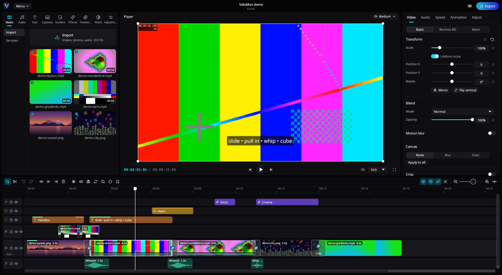

# VeloMov

**A lightweight FOSS video editor for Linux and Windows.** Native Rust, GPU compositing, keyframes,
transitions with real motion blur, effects, filters, text, stickers, animated auto captions and
FFmpeg export — with the familiar library / player / details / timeline layout of today's
social-video editors.

*Versão em português: [LEIA-ME.md](./LEIA-ME.md).*

## Download

**Windows 10/11 (64-bit)**: [VeloMov 0.8.0 (pre-release)](https://github.com/dukdanick/velomov/releases/tag/v0.8.0)

* [`VeloMov-0.8.0-windows-x64-setup.exe`](https://github.com/dukdanick/velomov/releases/download/v0.8.0/VeloMov-0.8.0-windows-x64-setup.exe): installer
* [`VeloMov-0.8.0-windows-x64-portable.zip`](https://github.com/dukdanick/velomov/releases/download/v0.8.0/VeloMov-0.8.0-windows-x64-portable.zip): portable, no installation

**Linux**: AppImage coming soon! In the meantime, build from source. see [Install](#1-install).



## Highlights

| | |
|---|---|
| **Familiar UI** | Library on the left (media, audio, text, captions, stickers, effects, transitions, filters, adjustment), player in the middle, details on the right, multi-track timeline with main-track magnet at the bottom. English and Brazilian Portuguese (follows `LANG`). |
| **Timeline** | Main track magnet, auto snapping, audio/video linkage, split (`Ctrl+B`), split mode (`B`), delete left/right (`Q`/`W`), trims, ripple delete, drag & drop between tracks, groups, markers, in/out range, freeze frame, reverse, extract audio, copy/paste attributes, unlimited undo. |
| **Keyframes** | Position, scale, rotation, opacity, volume, every adjust slider, filter/effect intensity and masks. Diamond on every property, keyframe curves (linear, ease in/out, smooth, overshoot, bounce, hold), keyframes draggable on the timeline. |
| **Transitions** | 56 transitions (Basic, Camera, Slide, Wipe, Blur, Glitch, Light, Shape, 3D): mix, black fade, white flash, pull in/out, whip pans, slide in/out, spin, cube, flip, door, glitch, light leak, heart/star/circle wipes… Movement-based ones use **true motion blur** (adjustable). A transition is centred on the cut, so it **never changes the length** of the video. |
| **Animations** | In / Out / Combo animations for clips, text and stickers (slide, zoom, spin, bounce, pop, drop, typewriter, heartbeat…) with motion blur. |
| **Effects & filters** | 44 effects (blur, zoom lens, shake, glitch, RGB split, VHS, old film, CRT, halftone, fisheye, kaleidoscope, glow, light leak, split screen, snow, rain, night vision…) and 31 colour filters. |
| **Adjust** | Brightness, contrast, saturation, exposure, temperature, tint, highlights, shadows, whites, blacks, sharpen, clarity, fade, vignette, grain, hue — curves tuned for video. |
| **Video tools** | Transform gizmo in the player (move/scale/rotate with centre snapping), crop, canvas blur/colour, 14 blend modes, masks (linear, mirror, circle, rectangle, heart, star) with feather, chroma key, speed 0.1×–100× and speed curves (Montage, Hero, Bullet, Jump Cut, Flash In/Out, Velocity). |
| **Audio** | Waveforms, volume (dB) with keyframes, fade in/out, silence removal, noise reduction, voice effects, synthesised sound effects (whoosh, whip, pop, boom, riser…), pitch-preserving speed changes. |
| **Auto captions** | Speech recognition with whisper.cpp, on your computer (on the GPU through Vulkan when available). Word-timed captions in 12 animated styles — karaoke, highlight, word box, pop, bounce, reveal, one word, glow, underline, spotlight, bubble, classic — switched for all captions at once. Choice of speech model (tiny … large-v3, downloaded on first use), explained in Settings. Fixing a word keeps the timing. |
| **Text & stickers** | Any system font, stroke, background box, shadow, letter/line spacing, presets; vector and emoji stickers. |
| **Export** | H.264, HEVC, AV1, VP9, ProRes, GIF, GPU encoding (VA-API), 480p–4K, 24–60 fps, audio only (MP3/AAC/WAV/FLAC), in/out range. The exporter uses the same compositor as the preview. |

## 1. Install

### Linux

Requirements: Rust 1.80+, FFmpeg 6+ (`ffmpeg` and `ffprobe` in `PATH`), a Vulkan or OpenGL capable GPU.

```bash
# Arch / CachyOS / Manjaro
sudo pacman -S --needed rust ffmpeg shaderc
# Debian / Ubuntu
sudo apt install cargo build-essential ffmpeg libasound2-dev pkg-config curl glslc

cd velomov            # the source folder
./install.sh          # builds the optimised version and installs it to ~/.local (no root)
```

`install.sh` also builds **whisper.cpp** (speech recognition for auto captions) into
`~/.local/lib/velomov/whisper/`, using the GPU through **Vulkan** when `glslc` (package `shaderc`)
is installed; without it, the processor only. To redo just that part:
`packaging/linux/build-whisper.sh`.

To remove: `./uninstall.sh` (projects and downloaded speech models are kept).

### Windows

The ready files are in `dist/`:

* `VeloMov-0.8.0-windows-x64-setup.exe` — **installer** (Portuguese/English; Start menu and desktop
  shortcuts, opens `.vcut` files, uninstalls from Windows settings). No administrator needed.
* `VeloMov-0.8.0-windows-x64-portable.zip` — **portable**: unzip anywhere (or onto a USB stick) and
  run `velomov.exe`. Projects, settings and cache stay in the `data` folder next to the program
  (the `portable.txt` file turns this on; delete it to use `%APPDATA%\VeloMov`).

Both bundle FFmpeg and whisper.cpp (GPU through Vulkan, with the processor as fallback; no Visual
C++ runtime needed). Requires 64-bit Windows 10 or 11.

**Building them again** (after changing the code), on Linux:

```bash
packaging/windows/build-cross.sh                    # installer + portable in dist/
SKIP_INSTALLER=1 packaging/windows/build-cross.sh   # portable only
```

The first run downloads what it needs into `~/.cache/velomov-cross` (Rust for Windows, llvm-mingw,
FFmpeg, whisper.cpp and Inno Setup, which runs under wine) — no root needed. After building, that
folder can be deleted; the files in `dist/` keep working.

**Building on Windows itself**: install Rust (https://rustup.rs) and, in PowerShell, in the source
folder: `powershell -ExecutionPolicy Bypass -File packaging\windows\build-windows.ps1`
(the installer is made when Inno Setup 6 is installed).

## 2. Open

* From the application menu: **VeloMov** (Multimedia), or in a terminal: `velomov`
* `velomov project.vcut` opens a project; `velomov clip1.mp4 clip2.mp4` makes a project with the
  files (on the main track, in order)
* without installing: `./run.sh`

Projects auto-save to `~/.local/share/velomov/projects` (Windows: `%APPDATA%\VeloMov\projects`);
caches live in `~/.cache/velomov` (Windows: `%LOCALAPPDATA%\VeloMov`).

## 3. Editing

1. **Create project** on the home screen (or **Demo project** to see everything working). The new
   project window asks for the **name** (default "New Project"), **aspect ratio** (16:9, 9:16, 1:1,
   4:5… *Auto* = like the first video, or *Custom* with any width × height), **resolution** (480p to
   4K), **frame rate** (24–60) and **background colour**. You can keep everything and click
   **Create project** (or Enter). All of it can be changed later in the **Details** panel (click an
   empty spot of the timeline).
2. **Import**: drag videos/photos/music from your file manager into the window, or `Ctrl+I`. Into
   an empty project they go straight to the timeline, in order. After that, dropped videos/photos go
   to the end of the main track and **music goes to the playhead, on an audio track** (`Ctrl+Z` undoes).
3. Drag media from the **Media** tab to the timeline (videos, photos **and music** are listed there).
   The bottom track is the **main track** (magnetic: clips stay together). Drop above it to make a
   **layer** (overlay); music dropped anywhere goes to an audio track.
4. **Several clips at once**: `Shift`+click selects **from the last clicked clip to the clicked one**
   (everything in between); `Ctrl`+click adds/removes one. With several selected, everything applies
   to all of them: dragging an edge resizes all, dragging moves all, the right panel (scale, opacity,
   animations, adjust, volume, speed…) changes all, and effects, filters, adjustments and transitions
   clicked in the library go on each one. The timeline has scrollbars on the right (tracks) and at
   the bottom (time).
5. **Split**: put the playhead there and press `Ctrl+B`. `Q` deletes what is left of the playhead,
   `W` what is right of it.
6. **Transitions**: click the **+** that appears between two clips of the main track and pick one in
   the **Transitions** tab (or drag the transition onto the cut). Click the transition to set its
   length and **motion blur** (slide, pull in, whip, spin…). The transition is centred on the cut,
   so **the video does not get shorter** when you add one. Old projects with transitions are
   converted when opened, without changing their length or moving anything.
7. **Effects / Filters / Text / Stickers / Adjustment**: click an item in the library (it goes to the
   playhead) or drag it to the timeline. Hover an effect/transition to preview it.
8. **Properties**: select a clip — the right panel has Video (transform, blend, motion blur, canvas,
   crop, mask, remove background), Audio, Speed (including curves like Montage/Hero/Bullet),
   Animation (in/out/combo) and Adjust (brightness, contrast…).
9. **Keyframes**: click the ◇ next to any property (or `Alt+K`), move the playhead and change the
   value — a new keyframe is made by itself. In the player you can drag, resize by the corners and
   rotate with the bottom handle (only inside the player area).
10. **Export**: the **Export** button (`Ctrl+E`) → resolution (up to 4K), codec (H.264, HEVC, AV1,
    VP9, ProRes, GIF or GPU/VA-API), frame rate, or audio only. The file goes to your Videos folder
    (can be changed).

On the home screen, **Select** (or `Ctrl`+click, or the circle in a project's corner) marks several
projects at once to **Duplicate** or **Delete**; `Ctrl+A` marks all.

GIF and WebP work as photos (1 frame) or as video (animated), keeping transparency.

### 3a. Animated auto captions

1. **Captions** tab in the library (left) → **Auto captions**.
2. Choose the **spoken language** (or *Detect automatically*), whether to listen to the **whole
   timeline** or only the **selected clips**, the **caption length** (Auto, One word, Short, Medium,
   Long) and the **style**.
3. **Generate captions**. The first time, the speech model is downloaded (Base = 142 MB, once).
   The captions go on a new text track, each with the timing of every word.

* **Changing the style**: **Captions → Styles** tab (hover to see the animation). A click changes
  **all** auto captions; with a text selected, only that one. Styles: Karaoke, Highlight, Word box,
  Pop, Bounce, Reveal, One word, Glow, Underline, Spotlight, Bubble and Classic.
* The caption's **Text** panel (right) has **Caption animation** (style and highlight colour) and
  **Apply look to all captions** (style, colours, font, size and position). Font, stroke, background
  and shadow work as for any text — and any ordinary text can be animated too.
* **Fixing a word**: edit the caption text; the word timings are kept (the panel shows "Now: …" with
  the word spoken at the playhead). Splitting and trimming captions keeps them in sync.
* **Speech model** (Settings → *Auto captions*), each explained on screen:

| Model | Size | What for |
|---|---|---|
| Tiny | 78 MB | fastest; more mistakes (above all in Portuguese and with noise) |
| **Base** (default) | 142 MB | balanced: quick and good for most videos |
| Small | 488 MB | more accurate for Portuguese, accents and noisy audio; ~3× slower |
| Medium | 1.5 GB | very accurate; slow on the processor, about 2 GB of memory |
| Large Turbo | 574 MB | almost Large, much faster — great for strong computers |
| Large | 3.1 GB | most accurate; very slow without a strong GPU, about 4 GB of memory |

  There you can also download/delete models, choose the number of threads and turn **Use the
  graphics card** on or off. On a Vega 11 with the GPU, Base recognises ~11 s of speech in ~2 s.
* Everything runs on your computer; nothing is uploaded (only the model is downloaded).

### 3b. Audio: silences and noise

Select a clip with sound (video or music) and open the **Audio** tab on the right:

* **Remove silences**: set *Below* (volume counted as silence, default −40 dB), *Min. length*
  (shorter silences stay) and *Margin* (breathing room kept before/after speech). The line shows how
  many stretches and seconds will go; click **Remove**. The clip is cut and the rest of the track
  moves up to close the gaps (`Ctrl+Z` undoes). Also in the clip's right-click menu →
  *Remove silences*.
* **Reduce noise**: removes hiss, hum, fans and wind; *Strength* from 10 to 100%. Applies to the
  preview and the export.

### 3c. Preview quality and performance

The player's top right corner has the quality button (gauge icon, **Medium** by default):

| Quality | What it does |
|---|---|
| **High** | the original files, at full resolution |
| **Medium** | **proxies** (light 540p copies) of heavy videos, renders up to 720p |
| **Low** | proxies, up to 480p and simplified effects — the lightest |

* Heavy videos (4K, HEVC/H.265, AV1, VP9, ProRes, above 1080p30) get a proxy automatically, made in
  the background. The **Media** tab shows ⚡ with a percentage while it is made and just ⚡ when it is
  ready; the player shows "Optimizing media". It pauses by itself while you play. **Exports always
  use the original files** at full quality.
* Hardware decoding is on by default (VA-API on Linux, D3D11/DXVA on Windows); if the GPU can't
  decode a file, VeloMov switches to the processor for that file only. When a video has more frames
  than the preview shows (60 fps in a 30 fps project), the extra ones are not decoded at all.
* The UI never waits for decoding: decoders run in the background, pre-roll before cuts and
  transitions, and never show a black frame while a video seeks.
* Decoding happens at the size shown (¼, ½ or full); colour conversion, adjustments, masks, blending,
  transitions and motion blur run on the GPU (wgpu / Vulkan).
* One program (~20 MB). Idle: **0 % CPU**, ~130 MB RAM. Measured on a Vega 11 with phone-style
  **4K60 HEVC 10-bit** footage and a whip transition: no late frames at any quality.

### 3d. Settings

On the home screen click **Settings**, or in the editor **Menu → Settings**:

* **Appearance**: theme (Black — default —, Pure black, Graphite, Midnight blue, Plum) and **accent
  colour** (8 presets or any colour under *Custom*). Applies at once, no restart.
* **General**: language, photo duration, auto-save.
* **Performance**: preview quality, hardware decoding, proxies.
* **Auto captions**: speech model (each one explained), GPU, threads.
* **Storage**: cache files (extracted audio, proxies, thumbnails) are **deleted by themselves** after
  **7 days unused** — or 1, 3, 14, 30 days, or *Never*. Shows the current size and has **Clear cache
  now**. Nothing is lost: VeloMov makes again whatever it needs.

## 4. Keyboard shortcuts

| Keys | Action | Keys | Action |
|---|---|---|---|
| `Space` | play / pause | `Ctrl+B` | split the selected clip |
| `J` `K` `L` | back / pause / forward (again: 2×, 4×) | `Ctrl+Shift+B` | split all tracks |
| `←` `→` | previous / next frame | `Q` / `W` | delete left / right of the playhead |
| `↑` `↓` | previous / next cut | `B` / `A` | split mode / select mode |
| `Home` `End` | start / end | `Delete` · `Shift+Delete` | delete · ripple delete |
| `Alt+K` | add / remove keyframe | `Alt+[` `Alt+]` | previous / next keyframe |
| `P` | main track magnet | `N` | auto snapping |
| `~` | audio/video linkage | `S` | preview axis |
| `F` | freeze frame | `Ctrl+Shift+R` | reverse |
| `Ctrl+Shift+S` | extract audio | `R` | rotate 90° |
| `Ctrl+G` / `Ctrl+Shift+G` | group / ungroup | `Ctrl+D` | duplicate |
| `M` | marker | `I` / `O` | in / out (export only a part) |
| `Ctrl+E` | export | `Ctrl+Shift+F` | full-screen preview |
| `Ctrl+Z` / `Ctrl+Shift+Z` | undo / redo | `?` or `F1` | full list |

## 5. If something goes wrong

* **No sound**: VeloMov uses the default output (PipeWire/ALSA on Linux). Run `velomov` in a
  terminal and look for the `audio output: …` line.
* **Dragging files does not work** (Linux): VeloMov runs through XWayland to accept drag and drop.
  For native Wayland: `VELOMOV_WAYLAND=1 velomov` (then import with `Ctrl+I`).
* **Choppy preview**: use **Medium** or **Low** quality in the player and wait for the video's ⚡.
  Check in Settings that *Hardware decoding* is on.
* **Captions fail**: in Settings → Auto captions, turn off *Use the graphics card*. If "speech
  recognition is not installed" shows on Linux, run `packaging/linux/build-whisper.sh`.
* **Graphics card**: needs Vulkan, DirectX 12 (Windows) or OpenGL; to force OpenGL:
  `WGPU_BACKEND=gl velomov`.
* Clearing caches (audio, reversed clips, proxies and thumbnails): Settings → Storage.

## 6. For developers

```
src/
  model/      project, tracks, clips, keyframes, editing operations (split, trims, magnet…), catalogs
  engine/     wgpu compositor: layers, motion blur, transitions, effects, colour (shaders.wgsl), animated captions
  media/      ffprobe, FFmpeg decoders, audio cache + mixer, thumbnails, proxies, sound effects, transcription (whisper)
  app/        egui UI: home, library, player + gizmo, inspector, timeline, shortcuts, export, captions
  export.rs   GPU render → FFmpeg, audio mix
  playback.rs real-time audio output (cpal); the audio clock drives the playhead
packaging/    Linux .desktop, whisper build, Windows build/installer
```

* **Motion blur**: the composite shader integrates each layer's transform over a virtual shutter
  (start / middle / end of the frame), with more samples the larger the displacement.
* **Captions**: whisper-cli makes one word per segment (`-ml 1 -sow`); words are grouped into lines
  and every style computes, each frame, the colour, scale, offset and opacity of each word.
* **Sound effects** are synthesised: pink-noise air passes, Doppler drop, turbulence and stereo pan,
  plus a small Schroeder reverb.

```bash
velomov --make-demo DIR                 # generate demo media and DIR/demo.vcut
velomov --new-project P.vcut a.mp4 b.mp4
velomov --render-frame P.vcut 2.5 out.png --height 720
velomov --export P.vcut out.mp4 --res 1080 --codec hevc --quality higher
velomov --captions P.vcut --lang pt --style karaoke [--model base] [--no-gpu]
velomov --catalog-sheet DIR             # contact sheets of every transition/effect/filter/animation
VELOMOV_SCRIPT=test.txt velomov P.vcut  # replay UI input (see src/app/script.rs)
VELOMOV_STATS=1 velomov                 # late-frame statistics
VELOMOV_DEBUG_DECODE=1 velomov          # log decoder restarts
```

Environment: `VELOMOV_WAYLAND=1` forces native Wayland, `VELOMOV_NO_AUDIO=1` turns sound off,
`VELOMOV_NO_HW=1` turns hardware decoding off, `VELOMOV_WHISPER=/path/whisper-cli` picks the
whisper program, `WGPU_BACKEND=gl` uses OpenGL.

## License

GPL-3.0-or-later. See [LICENSE](LICENSE).
